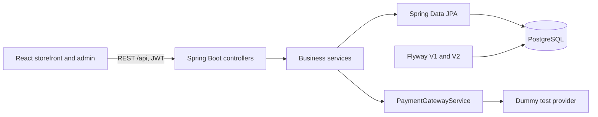

# Gadgetly architecture

Gadgetly is a demo e-commerce application with one browser client and one Java API. The
PostgreSQL database is the source of truth for accounts, inventory, carts, orders and payments.
The React client owns only presentation state and a guest cart before sign-in.

## Boundaries

- `gadgetly-frontend`: Vite/React/TypeScript, React Router, TanStack Query for server data,
  Zustand for authentication and the pre-login cart. Axios attaches the access token and
  refreshes it once after a 401. Auth changes clear private cached data.
- `gadgetly-backend`: controllers validate HTTP input, services enforce ownership and business
  rules, repositories persist entities. `/api/admin/**` requires `ROLE_ADMIN`; customer
  endpoints use the authenticated principal's user ID.
- Database schema and the two demo-data migrations are owned by Flyway. JPA uses `validate`
  outside tests. Add a new migration for future schema/data changes; never edit an applied one.
- `PaymentGatewayService` isolates payment processing. The configured `dummy` implementation
  simulates card, UPI, net-banking and COD outcomes. It sends no money and is not a real gateway.

## Shopping and checkout

1. The public catalog returns active products. Category browsing includes descendant
   categories. Admin product listing also includes hidden products; hiding keeps existing
   order and review references intact.
2. A visitor may add products to a local guest cart. After login or registration, the client
   transfers those items to the server cart, where the authenticated user owns each item.
3. Checkout uses a saved address owned by that user. The API snapshots shipping and item
   prices in a new order, reserves stock and clears the cart in one transaction.
4. Payment initiation uses the order's stored total. The API checks the order/payment owner,
   accepts verification only against the stored provider reference, and prevents concurrent
   attempts on the same order. Success confirms the order; failure keeps the reserved order
   available for another test payment. Accepted COD confirms the order with payment still due
   on delivery. Cancellation restores stock and unused coupon quota.
5. The checkout page stores a pending order ID in account-scoped local storage. A refresh or
   return to the account page can resume or cancel it. A confirmed order appears in history.

## Demo boundaries

The seeded accounts, JWT secret, placeholder product images and dummy gateway are for a local
lab only. Password reset is a mock response, and there is no real payment settlement,
shipping integration or invoice generation. Contact and tax details are intentionally omitted
until the shop supplies verified values. See `README.md` for setup and `IMPLEMENTATION_CHECKLIST.md`
for verification and remaining work.
